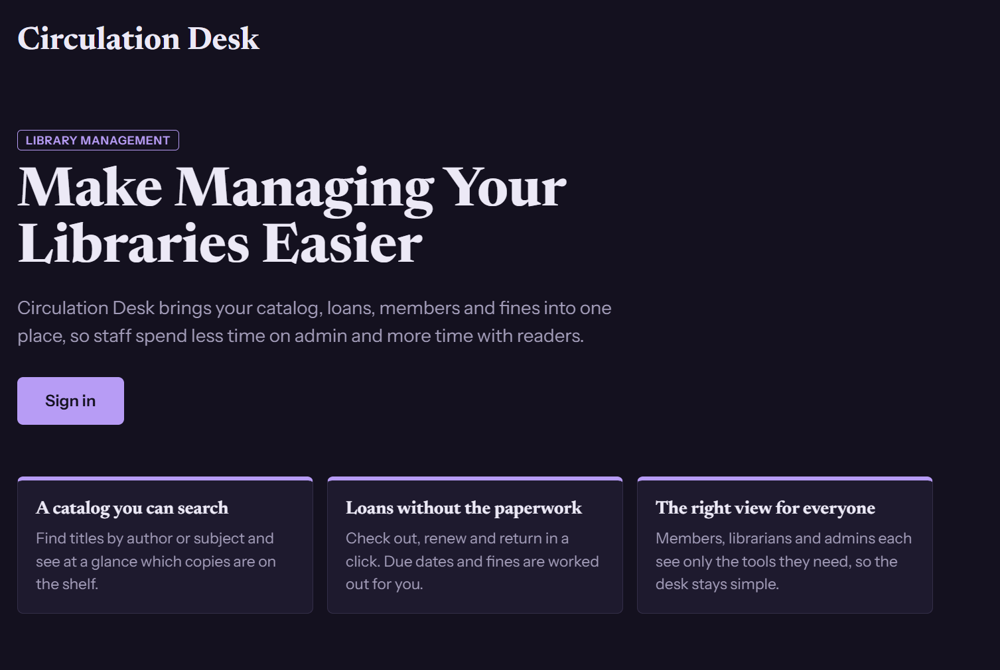

# Library Management System

A web app for managing a library's books, loans and members. Staff can browse the catalog, check out books, track what each member has borrowed, and see how much is owed for overdue books.

**Live demo:** https://library-management-system-rose-nine.vercel.app



## Features

- **Catalog:** browse books and sort them by category
- **Check-out:** check books out to members from the catalog
- **Loans:** see all books currently borrowed
- **Members:** see who has checked out what and how much each member owes for overdue books
- Responsive layout that works on desktop and mobile

## Tech Stack

- React
- Vite
- JavaScript, HTML, CSS
- Deployed on Vercel

## Getting Started

### Prerequisites

- [Node.js](https://nodejs.org/) (version 18 or newer)
- npm (comes with Node.js)

### Run locally

```bash
git clone https://github.com/dadatim/Library-Management-System.git
cd Library-Management-System
npm install
npm run dev
```

Then open the local address shown in your terminal (usually `http://localhost:5173`).

### Build for production

```bash
npm run build
npm run preview
```

## Project Structure

```
src/
  components/   # reusable React components (catalog, loans, members)
  App.jsx       # main app and navigation
  main.jsx      # entry point
```

## What's Next

- [ ] Staff login with role-based views
- [ ] Add/edit book form with ISBN and copy barcodes
- [ ] Backend and database so data is saved between sessions
- [ ] Search and filtering in the catalog

## What I Learned

- Structuring a UI into reusable React components
- Managing state across several views (catalog, loans, members)
- Deploying a Vite + React app to Vercel

## Author

**Timothy Dada**
[GitHub](https://github.com/dadatim) | [LinkedIn](https://www.linkedin.com/in/timothy-dada-b2a277309/)
